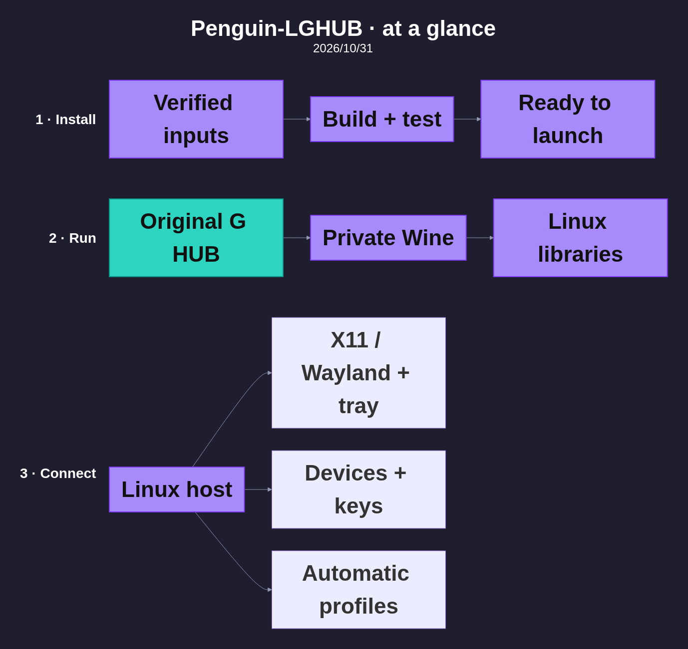
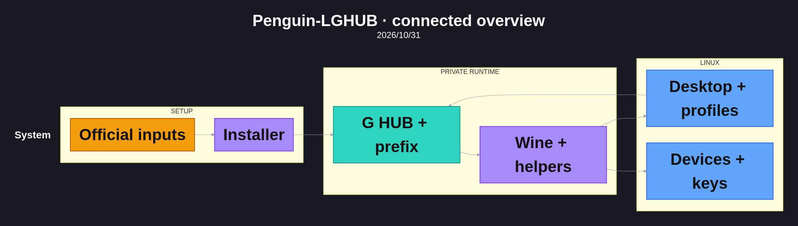

<h1 align="center">Penguin LGHUB</h1>

<p align="center">
  
</p>
<hr>

<h2 align="center">Support the project</h2>

<p align="center">
  <a href="https://ko-fi.com/cencyte"></a>
  <a href="https://buymeacoffee.com/cencyte"></a>
  <a href="https://www.patreon.com/cw/cencyte"></a>
</p>

<h3 align="center">Share the project</h3>

<p align="center">
  <a href="https://www.reddit.com/submit?url=https%3A%2F%2Fgithub.com%2FCencyte%2FPenguin-LGHUB&amp;title=Penguin-LGHUB" title="Share on Reddit"></a>
  <a href="https://bsky.app/intent/compose?text=Penguin-LGHUB%20https%3A%2F%2Fgithub.com%2FCencyte%2FPenguin-LGHUB" title="Share on Bluesky"></a>
  <a href="https://s2f.kytta.dev/?text=Penguin-LGHUB%20https%3A%2F%2Fgithub.com%2FCencyte%2FPenguin-LGHUB" title="Choose your Mastodon or Fediverse server via Share₂Fedi"></a>
  <a href="https://x.com/intent/tweet?text=Penguin-LGHUB&amp;url=https%3A%2F%2Fgithub.com%2FCencyte%2FPenguin-LGHUB" title="Share on X"></a>
  <a href="https://www.threads.com/intent/post?text=Penguin-LGHUB%20https%3A%2F%2Fgithub.com%2FCencyte%2FPenguin-LGHUB" title="Share on Threads"></a>
  <a href="https://www.facebook.com/sharer/sharer.php?u=https%3A%2F%2Fgithub.com%2FCencyte%2FPenguin-LGHUB" title="Share on Facebook"></a>
  <a href="https://www.pinterest.com/pin/create/button/?url=https%3A%2F%2Fgithub.com%2FCencyte%2FPenguin-LGHUB&amp;media=https%3A%2F%2Fraw.githubusercontent.com%2FCencyte%2FPenguin-LGHUB%2Frelease%2Fassets%2Fpenguin-lghub-logo.png&amp;description=Penguin-LGHUB" title="Share on Pinterest"></a>
  <a href="https://t.me/share/url?url=https%3A%2F%2Fgithub.com%2FCencyte%2FPenguin-LGHUB&amp;text=Penguin-LGHUB" title="Share on Telegram"></a>
  <a href="https://social-plugins.line.me/lineit/share?url=https%3A%2F%2Fgithub.com%2FCencyte%2FPenguin-LGHUB&amp;text=Penguin-LGHUB" title="Share on LINE"></a>
  <a href="https://service.weibo.com/share/share.php?url=https%3A%2F%2Fgithub.com%2FCencyte%2FPenguin-LGHUB&amp;title=Penguin-LGHUB" title="Share on Weibo"></a>
  <a href="https://connect.ok.ru/dk?st.cmd=WidgetSharePreview&amp;st.shareUrl=https%3A%2F%2Fgithub.com%2FCencyte%2FPenguin-LGHUB&amp;title=Penguin-LGHUB" title="Share on OK.ru"></a>
  <a href="mailto:?subject=Penguin-LGHUB&amp;body=https%3A%2F%2Fgithub.com%2FCencyte%2FPenguin-LGHUB" title="Share by email"></a>
</p>

## Table of contents

- [AI Disclosure](#ai-disclosure)
- [Introduction](#introduction)
  - [Current status](#current-status)
- [Diagrams: LGHUB Wine Compatibility System](#diagrams-lghub-wine-compatibility-system)
- [Warning](#warning)
- [Distribution setup status](#distribution-setup-status)
  - [Recorded test environments](#recorded-test-environments)
- [Installation](#installation)
  - [Installation requirements](#installation-requirements)
  - [Checking this computer's compatibility](#checking-this-computers-compatibility)
  - [Automatic application profiles](#automatic-application-profiles)
- [What the project contains](#what-the-project-contains)
- [Running project tests](#running-project-tests)
- [Additional details](#additional-details)
- [Branding and licenses](#branding-and-licenses)
- [Glossary of terms](#glossary-of-terms)

## AI Disclosure

*"Roughly 90% of the text on this Github from below this point originates from the LLM agent's voice. I have revised and edited the text in the page through the agent, but the pen is not my own. I plan to rewrite many sections of text here myself in due time, and I'd also welcome human-authored contributions to this repo's README, if you'd feel that sections should be worded differently for better clarity, completeness, and tone. Thank you."*

### Agent info:

Project execution: Cencyte D.<br>
AI model(s) used: GPT-6-Astra xhigh<br>
Agentic harness: codex-cli 0.163.0<br>
Dalia scale rating: D3 - *"Human & AI Teamwork. The human and AI act as creative partners."*<br>
Learn more: [Dalia scale](https://daliascale.org)

## Introduction

Penguin-LGHUB is an experimental compatibility layer for running the original **Logitech G HUB** on Linux through a custom Wine runtime. The working setup retains the actual G HUB agent and main interface for device configuration, key bindings, macros, profiles, lighting and G-Shift.

### Current status:

**Version 1.0.0** completes the recorded manual acceptance tests on Manjaro and CachyOS with X11/Plasma Wayland, and Bazzite with Plasma Wayland. The installer builds the custom Wine components from pinned source, acquires the required vendor resources, prepares a dedicated prefix and installs one desktop launcher. The final tests cover uninstall/reinstall, automatic application profiles, key delivery, tray actions and window resizing/restoration. This remains an experimental source release; no compiled Wine runtime is hosted. See the [v1.0 release notes](docs/packaging/release-v1.0.0.md) for the tested scope.

## Diagrams: LGHUB Wine Compatibility System

<p align="center"><a href="https://github.com/Cencyte/Penguin-LGHUB/blob/release/docs/architecture/2026-10-31/simple-modular.png"></a><br><a href="https://github.com/Cencyte/Penguin-LGHUB/blob/release/docs/architecture/2026-11-01-v1/detailed-modular.png">Expand detail</a><br><a href="https://github.com/Cencyte/Penguin-LGHUB/blob/release/docs/architecture/2026-10-31/simple-connected.png"></a><br><a href="https://github.com/Cencyte/Penguin-LGHUB/blob/release/docs/architecture/2026-11-01-v1/detailed-connected.png">Expand detail</a></p>

## Warning:

<details>
<summary><strong>⚠️ Requires a custom-patched, version-pinned Wine runtime</strong></summary>

The tested baseline is **Wine 10.20 with this project's patches**, paired with **G HUB 2026.6.974819**. Neither stock Wine nor another Wine version is an interchangeable replacement. The source installer builds a complete private runner and dedicated prefix, independent of system Wine. Its recorded Linux-library checks, fresh-prefix activation, first-run UI and native tray registration pass in the pinned userspace. Target GPU/device and full installation acceptance remain separately recorded. The older Desktop runner retains a host Wine 10.20 dependency.


</details>

<details>
<summary><strong>⚠️ Installation requires sudo permissions</strong></summary>

Setup requests sudo for scoped Logitech device-access rules. It checks host prerequisites without upgrading or installing system packages. The container launcher runs as a regular user through pressure-vessel/bubblewrap; it does not require sudo at each launch. The older workstation runner uses a privileged private mount namespace before dropping privileges. Do not run G HUB itself as root.


</details>

<details>
<summary><strong>⚠️ Installation requires 31 GiB of free working space</strong></summary>

Allow **31 GiB free on the filesystem containing the installation directory** (about 33 GB in decimal units). The pinned recipe uses an offline stage budget, including filesystem overhead and 2 GiB of free headroom. Verified temporary inputs and test copies are removed as installation progresses. This is free working space, not the download size or the final application's size. Use `--directory` to choose another local filesystem with enough room.

</details>

<details>
<summary><strong>⚠️ Experimental code. Use at your own risk.</strong></summary>

This compatibility project is tested on the recorded systems and devices, but it is not a guarantee for every configuration. Back up G HUB profiles before replacing or removing an installation. Review the dependency-use notices, expect possible regressions, and retain the installer log when reporting problems. Screen-sampled lighting, Flatpak application identities and non-KWin Wayland compositors remain unqualified.

</details>

## Distribution setup status


The v1.0 release targets **Manjaro, CachyOS and Bazzite**. Final manual acceptance
passed on Manjaro and CachyOS in X11 and Plasma Wayland, and on Bazzite in
Plasma Wayland. Other distributions are outside this release.

The intended setup uses a dedicated, version-pinned Wine runtime and its own
G HUB prefix, alongside any Wine already installed on the system. Device-access
setup requires sudo; G HUB itself runs as a regular user. Updates are
controlled so that a vendor update cannot silently replace the tested setup.

The [installer](docs/packaging/release-installer.md) includes automatic session selection, native application-profile switching, the shared keyboard-connection fix, window restore/resize corrections and the 31 GiB storage budget. Installer **0.3.10** completed the final uninstall/reinstall and regression acceptance on all three targets, reported November 1. Version 1.0.0 promotes that tested Preview 8 implementation without changing its installer or runtime behavior. See the [Bazzite findings](docs/packaging/bazzite-readiness.md) for graphics, audio, device, SELinux and full-X11-session considerations.

[](https://github.com/Cencyte/Penguin-LGHUB/actions/workflows/packaging-tests.yml)

### Devices tested:

| Device | Model |
|---|---|
| Mouse | G502 X Plus |
| Keyboard | G915 TKL |

### Recorded test environments:

Versions are comparison points, **not minimum requirements or a compatibility guarantee**.
Package inventories retain their collection dates; final manual acceptance was
reported November 1. The Bazzite inventory comes from the booted October 30
report. Full revisions, evidence and validation boundaries are in the
[environment record](packaging/tested-environments.json).

| Component | Manjaro desktop | Manjaro VM | CachyOS | Bazzite |
|---|---|---|---|---|
| OS / snapshot | 26.0.0 | rolling, Oct 28 | rolling, Oct 28 | 44.20261026.0 |
| Kernel | 6.12.74-rt16¹ | 6.12.77 | 7.2.9 | 7.2.11 |
| Graphics | NVIDIA RTX 3090 | VirtIO / Mesa llvmpipe³ | NVIDIA GT 730 | NVIDIA RTX 3090 |
| KWin | 6.5.4 | 6.5.5 / 6.5.6³ | 6.7.5 | 6.7.5 |
| Xwayland | 24.1.9 | 24.1.9 | 24.1.13 | 26.0.99.903 |
| libei | 1.5.0 | 1.5.0 | 1.6.0 | 1.6.0 |
| Portal / KDE backend | 1.20.3 / 6.5.4 | 1.20.3 / 6.5.6 | 1.22.1 / 6.7.5 | 1.22.1 / 6.7.5 |
| Tested session | X11/Wayland | X11/Wayland | X11/Wayland | Wayland² |

¹ The original X11 baseline used 6.6.128; the latest Manjaro Wayland/profile/input tests used 6.12.74-rt16.
² Bazzite runs G HUB through Xwayland inside Plasma Wayland. A full X11 desktop
session is not supplied or qualified. The VM results cover UI/session behavior;
physical Logitech hardware was tested on bare metal. The final installer 0.3.10
acceptance covers uninstall/reinstall, automatic Kate profiles, key delivery,
tray actions and resize/restore behavior on the applicable target sessions.
The original Manjaro workstation retains separate development-installation evidence.
³ The VM has a VirtIO display adapter with 3D acceleration disabled; its isolated
OpenGL tests use Mesa llvmpipe (CPU software rendering). No physical GPU is
passed through. Its November 1 resize checks used KWin 6.5.5 on X11 and 6.5.6
on Wayland, with Mesa 26.0.2. Graphics evidence and complete package revisions are retained
in the linked record to keep this table compact.

Shared application baseline: **G HUB 2026.6.974819**, custom **Wine 10.20**,
Steam Linux Runtime **4.0.20260928.262390**. The Wayland route uses Wine's patched
X11 driver, Xwayland, libei and KWin authorization; it is not Wine's native Wayland driver.
Bazzite's tested installation target is its default Plasma Wayland session.

[Reddit discussion and original announcement](https://www.reddit.com/r/LogitechG/comments/1xe5jw2/comment/19rp0hjphnyjo/?context=1&screen_view_count=2)

## Installation:

### Installation requirements:

Use a supported x86-64 KDE desktop, a regular user with sudo access, and **31 GiB free on a native Linux filesystem** (for example ext4, Btrfs or ZFS). The installer checks required host tools before acquisition; see the [full prerequisites](docs/packaging/release-installer.md).

Run in the target OS's normal KDE desktop terminal, as a regular user:

```sh
git clone https://github.com/Cencyte/Penguin-LGHUB.git Penguin-LGHUB-release
cd Penguin-LGHUB-release
./install.sh
```

With installer **0.3.6 or newer**, installation is the default; the explicit `--install` flag remains supported. `--help`, `--check` and `--uninstall` retain their separate actions.

Allow **31 GiB of free working space** for the initial source build and acquisition. All command output is saved to the log path printed below the logo.

One **Penguin-LGHUB** launcher automatically selects X11 or KDE Plasma Wayland at each launch. Both paths share the same Wine runtime, prefix and G HUB settings. Quit G HUB before logging out to change sessions; no reinstallation is needed. Wayland input still requires KDE's permission when prompted.

**Installation is transactional:** a new setup commits only after its required steps pass. A failed attempt rolls back its private files, downloads, launchers and device rule, retaining diagnostics. An already installed setup is preserved. Interrupted transactions are recovered before a new attempt; cleanup failures are reported explicitly. See [transaction and recovery details](docs/packaging/release-installer.md#transactions-and-recovery).

Optional switches, added to the installation command:

- `--directory /path/to/spacious/local/storage` — choose where the runtime, prefix and build files are stored.
- `--verbose` — also display each step's command output in the terminal.
- `--jobs 4` — choose 1–16 build jobs; the default is 4.
- `--engine podman` — use an existing rootless Podman installation for Windows-resource acquisition. The default is bubblewrap.

Standalone commands, run from the project directory:

- `./install.sh --help` — show usage, switches and examples.
- `./install.sh --check` — check the current host's installation prerequisites and save a report.
- `./install.sh --uninstall` — remove this managed installation, including G HUB settings, private Wine, downloaded inputs, launchers, icon and its device-access rule. Installer diagnostics are retained separately.
- `./install.sh --uninstall --directory /path/to/installation` — remove an installation stored at a custom location.

Back up any G HUB profiles or settings you want to keep before uninstalling. Removal works without a graphical session and requests sudo only for its device rule. The source download, independently generated diagnostic reports and unrelated software remain. Legacy lab installations without an ownership receipt require separate cleanup; they are not removed by guessing paths. If the selected installation directory is absent, the command reports that nothing was removed.

Alternatively, download **Penguin-LGHUB-v1.0.0-source.zip** from the [v1.0 release](https://github.com/Cencyte/Penguin-LGHUB/releases/tag/v1.0.0), extract it, and open a terminal in the extracted folder. Run `./install.sh` there; if executable permissions were lost during extraction, use `bash install.sh`. No Git checkout is needed for the ZIP workflow.

Version **1.0.0** includes the tested installer **0.3.10**, automatic X11/Wayland application-profile observers, the shared keyboard connection, profile-component verification, transactional removal and the **31 GiB** storage budget. When sudo needs a password, setup waits without a countdown for Enter before opening the password prompt. Wayland checks inspect Xwayland's native-input bridge and its portal or private EIS socket route. Window restore, resize and bottom-edge corrections are included and manually accepted; the full UI scales to smaller windows and repaints after resizing settles.

This release retains the Wine input fix introduced in Preview 3 for keys that remained held when G HUB worker threads sent the press and release through different Xwayland connections. The installer builds this fix automatically. [Isolated regression results](docs/packaging/host-keyboard-threads-verification.json) cover native Wayland and Xwayland destinations; the G502 X Plus fix is also manually confirmed on booted Bazzite and the Manjaro Wayland workstation.

### Checking this computer's compatibility:

Run this from the target KDE desktop terminal:

```sh
./install.sh --check
```

This checks the actual host's OS, CPU architecture, required tools, user namespaces, desktop session and the selected storage location’s Linux link/permission behavior. It records graphics drivers, audio-socket presence, SELinux state and Logitech device access. It also checks host libraries for both profile backends. On Wayland it checks Xwayland authentication, compiled libei keyboard support and either its enabled liboeffis portal route or KWin's private EIS socket, alongside KWin's operation mode, scripting interface and the input-control portal. An unreadable or ambiguous server is reported as unverified. It does not load a focus script, request input permission or send keys during `--check`. Blockers stop the check with an explanation; warnings identify remaining verification needs. A successful readiness check is followed by installation checks and hands-on device testing.

Readiness checking and installation share the same categorized step headers. In `--check` mode, each completed check shows an aligned `OK` or `FAIL` result. Installation uses descriptions with an activity spinner and no per-check result labels. `OK` means that check found no installation blocker; hardware acceptance and warnings remain separately reported. The complete host report is always saved with the log.

- `--verbose` — also display the host report in the terminal.

### Automatic application profiles:

Enable automatic profile switching in G HUB and associate a profile with the Linux application's executable. In the installed **Penguin-LGHUB** launcher, Kate's path is `Z:\run\host\usr\bin\kate`. Type the complete path into the file chooser's **File name** field: its executable filter hides extensionless Linux programs, and browsing a large `/usr/bin` can stall. The older **G HUB — Tested Wine** launcher instead uses `Z:\usr\bin\kate`.

Focus the application, then another application, and check that the active G HUB profile changes. The host observer supplies application identity to G HUB's original profile logic. On Wayland it uses a temporary KWin script; this is separate from input-control permission. One Share request can be normal on a new session with older Plasma, but every key press should not request fresh permission.

The installer supplies private build tools, Wine, Linux libraries and launcher helpers. The repository requires authorized GitHub access while it remains private. See [installation, recovery and validation details](docs/packaging/release-installer.md).

## What the project contains

| Resource | Source or configuration | Role |
|---|---|---|
| Custom Wine build | [46 patch topics](patches/wine/), [build/run tools](tools/wine/), [private runtime packager](tools/packaging/wine_runtime.py) | Windows API, composition, input, graphics, device and native key-output compatibility. The [source builder](tools/packaging/build_release_runtime.py) applies the complete series and compiles every changed module and helper inside the pinned SDK. A corresponding-source audit remains before hosting a binary runtime release. |
| Supplementary DLL implementations | [DirectComposition](tools/wine/dcomp_experiment.cpp), [CoreMessaging adapter](tools/wine/coremessaging_xp_adapter.c), [DispatcherQueue](tools/wine/dispatcher_queue_experiment.cpp), [CoreApplication](tools/wine/core_application_experiment.cpp), [ApiInformation proxy](tools/wine/api_information_proxy.cpp), [sensor fallback](tools/wine/sensor_monitor_unavailable.c) | Separate app-local helpers. Some implement only the contracts the observed application needs; they are not complete replacements for their Windows subsystems. |
| Local vendor-resource transformations | [Color preview](tools/wine/prepare_color_picker_fix.py), [tray background](tools/wine/prepare_tray_background.py) | Generate local modified assets from the acquired application. Do not treat generated `app.asar`, XBF or PRI files as project-owned source. |
| Prefix and launch definition | [Observed runtime baseline](packaging/runtime-baseline.json), [runtime registration helper](tools/wine/configure_runtime.py), [snapshot preparation](tools/wine/prepare_tested_desktop.py), [legacy launcher](tools/wine/tested_desktop_launch.py), [container launcher](tools/packaging/desktop_runtime.py) | Preserve the working configuration: 48 recorded file hashes, environment flags, DLL load policy and eight recorded WinRT activation classes. The baseline records evidence; the fresh-prefix generator and top-level installer turn it into the installed configuration. |
| Automatic application profiles | [Host observer](tools/wine/native_profiles.py), [KWin subscription](tools/wine/profile_kwin.py), [typed-event adapter](tools/wine/profile_event_bridge.c) | X11/KWin foreground identity is resolved outside the container, then passed through a private authenticated mailbox into G HUB’s original automatic-profile logic. The source build includes the adapter in `mfsensorgroup.dll`. |
| Diagnostics | [Agent snapshot](tools/wine/agent_snapshot.cjs), [color-picker recorder](tools/wine/color_picker_monitor.cjs), [composition regression runner](tools/wine/run_dcomp_tests.py) | Readiness, device/profile evidence and targeted regression checks. The Node helpers need a version with built-in WebSocket support. |
| Analysis tools and technical history | [DragonShard tools](tools/dragonshard-2/), [technical notes](docs/dragonshard/) | Optional contributor tools and saved findings. The earlier native remapper is not the backend of this G HUB/Wine path and is outside this source snapshot. Ghidra databases and full decompilation exports are not runtime dependencies. |

## Running project tests:

From the cloned project directory, run:

```sh
python3 tools/packaging/run_project_tests.py --run
```

These regression tests exercise the installer and launcher code with controlled sample data, temporary files and simulated failures. Python 3.12 or newer is required; JavaScript frontend fixtures also require Node.js on the development host. The runner saves complete test output to the printed log path, and keeps failure details visible. `OK` means the run completed without unexpected failures; the summary also reports skips and expected failures. The current combined suite contains **264 checks**, including profile routing, observer cleanup, native-input capability and authorization regressions.

- `--verbose` — show individual test results and captured output beneath the headers.
- `--log-file /path/to/new-tests.log` — choose a new log file; existing logs are preserved.
- `--help` — show usage and examples.

| Test area | What is checked |
|---|---|
| Downloads and extraction | Hash verification, encrypted sample depots, corrupt data and unsafe archive paths. |
| Wine and prefix preparation | File inventories, registry definitions, DLL policy and protection of existing directories. |
| Container and device policy | Generated isolation commands, scoped device access and per-application synchronization settings. |
| Desktop behavior | Launcher/startup/shutdown logic, tray-registration handling and frontend resource transformations. |
| Profiles and key output | Application identity, KWin bus authentication, stale events, observer cleanup, packaged prerequisites and threaded key-delivery measurements. |
| Installer workflow and removal | OS policy, step ordering, transactional rollback, help, logs, ownership receipts and safe removal of managed files. |

## Additional details

<a name="publication-gates"></a>

<details>
<summary><strong>Publication gates</strong></summary>

These checkpoints track dependency policy, installation reproducibility and release qualification.

1. **Resolve the complete dependency acquisition policy:** [Direct-media reconstruction](docs/packaging/dockur-acquisition.md#direct-media-reconstruction-verified-22-exact-matches) now reproduces both exact Windows DLLs from official downloads, without a donor VM. Component-use clearance remains pending; the current font recipe uses vendor-bundled BrownPro and private-runtime DejaVu Sans; see the [third-party notice and concrete permission inquiry route](docs/packaging/third-party-use.md). Manual extraction from a user's Windows installation is not the proposed public workflow.
2. **Verify the pinned vendor installation:** Clean acquisition and extraction pass for **30/30 selected depots, 1,115/1,115 files**, including the three encrypted resource depots. Every extracted file matches the working installation's depot cache. The manifest-driven application layout contains 438 files. A fresh prefix now passes eight activation-factory checks, four registry checks, updater service configuration and five agent API requests. Optional installer extensions and the remaining per-feature acceptance checks stay separately scoped. See the reproducible commands and exact scope below. Preserve vendor notices and review the applicable installation terms before automating deployment.
3. **Qualify the packaged runtime for release:** The complete Wine payload, matched server/client replacements and supplementary DLLs are now packaged and tested with host Wine hidden, including after relocation. A separate pinned Linux userspace now resolves all 46 native modules and all 54 recorded dynamic-library candidates without importing host graphics. The source build sequence now runs from the pinned SDK. The v1.0 source installer builds this runtime locally and has completed the recorded three-target acceptance. The corresponding-source binary-release audit remains required before hosting a compiled runtime archive.
4. **Finish and qualify the clean prefix:** The development recipe generates registry paths, overrides, factories, URL handler, a stopped updater service and update settings from acquired inputs. It copies no donor registry, personal settings or fonts. Font configuration, device policy, service startup, automatic profiles and launcher generation are integrated. The new source build removes the lab-artifact prerequisite. Installer 0.3.10 uninstall/reinstall and final regression acceptance are manually confirmed on Bazzite, CachyOS and the Manjaro VM.
5. **Current-installer acceptance completed:** The final November 1 report confirms the requested uninstall/reinstall and regression checks on all three targets, including automatic Kate profiles, key press/release behavior, tray actions and resize/minimize/restore. Manjaro and CachyOS cover X11/Plasma Wayland; Bazzite covers Plasma Wayland. The [acceptance record](docs/packaging/release-installer-verification.json) distinguishes this manual result from automated probes and preserves the hardware and feature boundaries.
6. **Keep releases reproducible and reviewable:** This source snapshot preserves GitHub's initial commit and excludes the lab history, captures, vendor payloads and populated prefixes. See the [source publication record](docs/packaging/source-publication.md). Wine notices remain LGPL; a complete corresponding-source/build-sequence audit is still required before publishing the packaged runtime binary.

</details>

<a name="verified-logitech-depot-extraction"></a>

<details>
<summary><strong>Verified Logitech depot extraction</strong></summary>

[The lock file](packaging/logitech-depots.lock.json) pins G HUB **2026.6.974819**, build **869589**, to official Logitech URLs, sizes, SHA-256 values, dependency closure and expected file lists. `tested_setup` selects the 30 depots marked present in the working setup, including the G502 X PLUS and G915 X LIGHTSPEED TKL resources. It does **not** cover all 779 catalog entries or claim support for every Logitech device. `core` selects the six-depot core closure; `required` follows the vendor-required roots and their dependencies.

The [extractor](tools/packaging/logitech_depots.py) downloads into an external cache, verifies each archive, extracts into a new directory and assembles the application-root copy rules. It never starts vendor executables, writes a Wine prefix, registers a service or changes host packages. It requires Python 3.12+ and OpenSSL's `libcrypto`; no third-party Python packages or Wine are needed for this step.

Choose an existing, spacious parent directory outside the repository, then run:

```sh
python tools/packaging/logitech_depots.py fetch \
  --work-dir /path/to/private-cache/logitech-2026.6.974819

python tools/packaging/logitech_depots.py stage \
  --work-dir /path/to/private-cache/logitech-2026.6.974819 \
  --output-dir /path/to/private-cache/logitech-2026.6.974819/stage-001

python tools/packaging/logitech_depots.py verify \
  --output-dir /path/to/private-cache/logitech-2026.6.974819/stage-001
```

The default selection downloads **910,350,368 bytes (868 MiB)**. Staging conservatively reserves twice the extracted payload size, in addition to a 2 GiB free-space floor; it never overwrites an existing stage. Downloads support checked resumption. Vendor downloads, keys, manifests, extracted files and full local receipts stay outside Git. The staged directories are `depots/<name>/` and `application/LGHUB/`; `extraction.json` records file hashes, layout origins and pending installer declarations. `verification.json` records the verified counts. Verification detects changes against that local receipt; it is not an independent signature on an editable receipt.

The encrypted resource keys are fetched without authentication from [Logitech's public access-group endpoint](https://updates.ghub.logitechg.com/pipeline/v2/access/20d0dda2-4c0c-4f5a-98d0-f9cf0819544b/content.json). Only the required key fingerprints are pinned, so adding unrelated keys upstream does not invalidate this recipe. A missing or changed required key fails closed. The observed capsule format uses AES-128-GCM's stream with PBKDF2-HMAC-SHA512-derived IVs, but stores no GCM tag; integrity is checked using the pinned depot hash and the vendor header/member hashes. Six mouse images are nested capsules: their decoded contents are verified while their installed encoding is preserved.

[Recorded validation](packaging/logitech-depots-verification.json): **100% of the 1,115 selected depot files** match the working cache byte-for-byte. Of the 438 assembled application files, 434 match the working application, two are the original tray resources that the runtime later patches, and two are legacy LED SDK DLLs absent from the working application directory. The original extraction validation passed **36 packaging tests**, including 12 depot/capsule tests. These figures measure extraction and file identity, not application-installation completeness.

The **43 recorded installer declaration groups** are now classified by the clean-prefix recipe: two configured, one replaced, two frozen, one partial, 35 deferred and two unresolved. The deferred groups include eight extension packages and 17 conditional/external copy rules. Two core copy rules name `trueforce_sdk_x86.dll` and `trueforce_sdk_x64.dll`, which are absent from the core archive; the separate Trueforce manager's installation must be investigated before claiming those rules complete. Counts describe declaration groups of different sizes, not a percentage of installer functionality.

</details>

<a name="wine-prefix-development-installer"></a>

<details>
<summary><strong>Wine prefix development installer</strong></summary>

The [preparation script](tools/packaging/prepare_clean_prefix.py) builds a **new** Wine prefix from the verified depot stage and reconstructed Windows DLLs. It generates depot metadata, public-key records, update settings, installation inventory, eight WinRT registrations and the `lghubapp` URL handler. It registers `LGHUBUpdaterService` through Wine's service manager with its correct command, deliberately **stopped and demand-start** pending full qualification. This differs from the existing Desktop installation's automatic service startup.

The preparation tool accepts either source of Wine components:

- `--runtime /path/to/private-work/wine-10.20-penguin` — use the complete private bundle, including the seven supplementary DLLs.
- `--compatibility-root /path/to/lab` — legacy comparison path requiring the lab layout and host Wine 10.20.

Neither path copies a donor registry, application settings, vendor application files or Windows fonts. The color-picker archive and two tray resources are transformed locally; all three resulting hashes match the working setup.

### Development prerequisites:

Python 3.12+, `bwrap` with working user namespaces, MinGW `x86_64-w64-mingw32-g++` for the validation helper, and the bundle's Unix-library dependencies. The backend probe additionally needs Xvfb and Node with built-in WebSocket support. No packages are installed by these commands. The private-bundle path supplies its own Wine. The legacy lab path still requires host Wine 10.20 and noninteractive sudo. This does not remove the overall project's host-device setup requirements.

```sh
python tools/packaging/prepare_clean_prefix.py \
  --stage /path/to/private-cache/logitech-2026.6.974819/stage-001 \
  --cache /path/to/private-cache/logitech-2026.6.974819 \
  --windows-dlls /path/to/private-cache/windows/reproduction-001/dlls \
  --runtime /path/to/private-work/wine-10.20-penguin \
  --output /path/to/private-work/clean-install-001

python tools/packaging/prepare_clean_prefix.py --verify-only \
  --output /path/to/private-work/clean-install-001

python tools/packaging/probe_clean_agent.py \
  --candidate /path/to/private-work/clean-install-001 \
  --output /path/to/private-work/clean-agent-001
```

Use new output directories outside the repository with existing parents. Preparation reserves 5 GiB above the 2 GiB free-space floor; the probe reserves another 4 GiB for its disposable clone. The candidate is left pristine; the agent test runs in that clone. Both use a read-only host filesystem, a private network and PID namespace, a private temporary directory and no physical device nodes. Wine processes are stopped within their own namespace after each check. The agent probe uses its own Xvfb with GLX disabled; it neither connects to the live desktop nor evaluates graphics performance. Acquisition inputs and host files remain readable inside this test environment: this is operational isolation, not a hardened sandbox for hostile executables.

[Initial validation](packaging/clean-prefix-verification.json) recorded 1,599 managed files with copied private builds. [Packaged-runtime validation](packaging/wine-runtime-verification.json) records 1,574 prefix files plus the separate 2,571-entry runtime inventory. Both pass **8/8 activation factories**, **4/4 registry routes**, **1/1 updater service configuration**, and **5/5 agent API routes**. The API test covers `/devices/list`, `/profiles`, `/profile/active`, `/profiles/auto_switching` and `/input/gshift`, each returning `SUCCESS`. No physical devices are exposed, so an empty device list is expected. These results establish fresh installation and backend startup; they do not establish working mouse bindings or profile switching on real hardware. The current combined packaging and desktop-device policy suite has **239 regression checks** locally; the CI badge reports the published revision’s result.

The private output contains `clean-prefix.json`, `verification.json`, `installer-actions.json` and per-step logs. Verification checks the managed application/depot/artifact trees and four installed Wine fallback modules against its local receipt; it does not authenticate an edited receipt or qualify all stock Wine files and mutable registry state. The probe writes `agent-verification.json`, its API snapshot and logs separately. None of those populated prefixes, vendor files or downloaded keys belongs in Git.

### Current validation:

The release installer integrates private libraries, fonts, original UI/tray checks and launcher generation. Manjaro/CachyOS desktop results and Bazzite installation, uninstall/reinstall and corrected physical mouse input are recorded above. Fresh installation on CachyOS and the Manjaro VM is also manually confirmed; automatic native X11/Wayland profiles and repaired Wayland key output are now manually confirmed on the Manjaro workstation. Optional vendor installers are not executed or falsely marked installed, and this recipe does not replace the user's working installation.

</details>

<a name="packaged-private-wine-runtime"></a>

<details>
<summary><strong>Packaged private Wine runtime</strong></summary>

[The runtime lock](packaging/wine-runtime.lock.json) pins the complete runtime payload from [Arch's Wine 10.20-2 archive](https://archive.archlinux.org/packages/w/wine/wine-10.20-2-x86_64.pkg.tar.zst), its detached signature, **20 Wine replacements**, five protocol markers and seven app-local compatibility DLLs. The archive's signature was verified against the installed Arch keyring: signer `D2E95FEC015CF1F911AAAB0C3D4C5008BB5C8D29` (Peter Jung). Subsequent fetches and builds enforce the pinned SHA-256 of both archive and signature. They do not download a key or change the system trust store.

The [packager](tools/packaging/wine_runtime.py) retains Wine's loader, preloader, matched wineserver, Unix/PE modules, NLS tables and Wine-provided fonts in their relative `usr/` layout. The supplementary DLLs occupy `compatibility/`; inventory, original package/build metadata, dependency evidence and the Wine license are included. Package installation hooks are never executed. The archive contains no G HUB payload, copied Microsoft Windows DLLs, proprietary Windows fonts or user prefix.

The standalone legacy archive assembler requires Python 3.12+, `zstd`, GNU `tar`, `readelf`, `ldd` and prebuilt compatibility artifacts. The standard installer instead uses the source builder and private SDK described above, including the profile adapter. The corresponding-source release audit is still required before publishing the binary artifact.

```sh
python tools/packaging/wine_runtime.py fetch --cache /path/to/private-cache/wine

python tools/packaging/wine_runtime.py build \
  --cache /path/to/private-cache/wine \
  --artifacts /path/to/private-compatibility-artifacts \
  --output /path/to/private-work/wine-10.20-penguin

python tools/packaging/wine_runtime.py verify \
  --runtime /path/to/private-work/wine-10.20-penguin

python tools/packaging/wine_runtime.py archive \
  --runtime /path/to/private-work/wine-10.20-penguin \
  --output /path/to/private-cache/wine-10.20-penguin.tar.zst

# Use the trusted SHA-256 recorded for that particular produced archive.
python tools/packaging/wine_runtime.py restore \
  --archive /path/to/private-cache/wine-10.20-penguin.tar.zst \
  --sha256 TRUSTED_ARCHIVE_SHA256 \
  --output /path/to/private-work/restored-runtime
```

Outputs must be new directories/files. Building and restoring reserve 2 GiB above the existing 2 GiB free-space floor. The measured local archive is **101,488,615 bytes (96.8 MiB)**. A restore verifies its whole-file checksum before extraction, then checks every recorded file/hash/mode/link and all pinned compatibility artifacts. The local receipt is not a replacement for authenticating a downloaded archive against its trusted release checksum.

The fresh installer masks the host's Wine module/data directories and loader/server executables during every packaged-runtime check. Its processes select the private loader and server explicitly. The agent probe records actual mapped runtime images; both the normal-path and relocated-path runs passed all five API routes. Relocation used a path containing spaces with the original runtime path absent. For an existing candidate after relocation, supply the runtime option on the agent probe:

- `--runtime /new/runtime/path` — the runtime must have the same manifest hash as the candidate's recorded runtime.

### Base Wine bundle:

The archive above supplies Wine itself; use the separate Linux userspace layer below for its native dependencies. The initial host audit inspected **46 ELF files** and found no unresolved `DT_NEEDED` libraries on the development host; their highest required glibc symbol version is **2.38**. This is a minimum symbol requirement, not a claim that every system with glibc 2.38 works. Direct dependencies include X11, libudev, libusb, libunwind and media/audio libraries; optional modules include FFmpeg 62/60 sonames. The subsequent container check below resolves the recorded dynamic-library candidates; codec behavior/plugins and host GPU drivers still require validation. `provenance/unix-dependencies.json` records per-module dependencies and candidate `dlopen` names. The complete source installer has since passed the recorded Manjaro, CachyOS and Bazzite acceptance; that result applies to its packaged userspace and recorded hardware, not arbitrary direct execution of this developer archive.

### Linux userspace verification, October 26:

The pinned Steam Linux Runtime 4 and private Debian library set now resolve **46/46 native Wine modules (100%)** and **54/54 candidate dynamic libraries (100%)**. Two upstream Unix modules (`winedmo.so` and `wpcap.so`) are rebuilt in the matching pinned SDK; all existing pinned compatibility artifacts are preserved. A real Windows command succeeds with no D-Bus assertion after the headless test stops exposing the host system bus. The same container also passes **8/8 WinRT activation checks, 4/4 registry checks and 5/5 read-only G HUB API requests** using pinned Node and an isolated Xvfb. These are dependency/backend checks, **not overall application completion**. See [the results and reproducible SDK/container checks](docs/packaging/linux-runtime.md). No system package changes, Steam installation or account are required for these checks; the working Desktop launcher is unchanged.

The same **46/46 + 54/54 + 8/8 + 4/4 + 5/5** checks now pass on both a newer Manjaro VM and a separate bare-metal CachyOS host. [Independent-host evidence](packaging/independent-host-verification.json) records the exact scope. The [X11 container launcher](tools/packaging/desktop_runtime.py) imports host graphics, shares the X11 session and permitted devices, uses a dedicated prefix, and supports reopen/stop actions. Its [usage and validation limits](docs/packaging/linux-runtime.md#x11-container-launcher) distinguish these passes from real graphics and peripheral acceptance.

</details>

<a name="dependency-sourcing-findings"></a>

<details>
<summary><strong>Dependency sourcing findings and the prefix question</strong></summary>

Research checked 2026-10-25. These are evidence-backed publication decisions, not a jurisdiction-specific legal opinion or a statement that every possible licensing agreement has been ruled out.

### Recommended common policy:

Distribute the audited project source, patches and reproducible configuration; acquire proprietary dependencies automatically from an authorized source under their applicable terms. Offer one setup flow to the user. Permission still has to be established behind the scenes for every required package; a common installer cannot grant a common license.

| Approach seen in compatibility projects | What the evidence establishes | Consequence here |
|---|---|---|
| Automatic download and local extraction | [Winetricks source](https://raw.githubusercontent.com/Winetricks/winetricks/master/src/winetricks) contains real vendor-download/extraction recipes, including the Microsoft SDK CAB recipe for `d3dcompiler_47`. This demonstrates a usable delivery mechanism, not universal permission for other DLLs. | Appropriate user experience if the actual source package and use are permitted. No manual Windows filesystem is necessary for such packages. |
| Open implementations | [CodeWeavers' explanation](https://www.codeweavers.com/compatibility/crossover/forum/platform-sdk-redistributable-gdi?msg=113851) distinguishes Microsoft's native binaries from Wine's independently licensed implementations. | Share the Wine implementation with its obligations; do not infer permission for a Microsoft file with the same name. |
| OS downloads, update CABs and symbol-server links | [Winbindex](https://github.com/m417z/winbindex) indexes binaries and links to Microsoft's symbol server. That index does not grant rights to Windows binaries. Windows terms reserve rights and restrict separate use and publication of OS components. | A technically downloadable file is not yet a cleared Linux runtime dependency. An ISO downloader or a DLL mirror does not close this gate. |
| Redistributable runtime packages | Microsoft publishes [Windows App Runtime redistributables](https://learn.microsoft.com/en-us/windows/apps/windows-app-sdk/downloads-archive), but the package's contents and terms determine its scope. | No verified package-and-license combination covering both pinned OS DLLs was established. The App SDK name or its source repository's MIT license does not license arbitrary Windows system files. |
| Written redistribution/use permission | A rights-holder can grant additional rights, subject to an actual agreement. | Investigate permission covering Linux use and automated acquisition or distribution of the complete required set; availability, terms and cost are unknown. Do not assume a purchasable blanket license exists. |

The expanded local manifest lists 779 depots. Its file lists contain neither `d2d1.dll` nor `ninput.dll`, nor the required Windows font filenames. **`D3DCompiler_47.dll` is a G HUB-bundled dependency from `core_runtime_win.depot`**; the tray uses a matching copy from the application root. This corrects the earlier classification of that file as Windows-installation-sourced. These are manifest/provenance observations, not a completed clean depot installation.

The [Windows 11 terms](https://www.microsoft.com/content/dam/microsoft/usetm/documents/windows/11/oem-%28pre-installed%29/Useterms_OEM_Windows_11_EnglishGreatBritain.pdf), section 2(c), restrict publishing and using features separately. The exact terms attached to a candidate acquisition still need checking. Hosting files on a project server and having an installer fetch them is still distribution. A ZIP, Wine prefix, container or private download does not supply a missing grant. Nor does modifying a binary erase the original rights: the [U.S. Copyright Office](https://www.copyright.gov/help/faq/faq-fairuse.html) explains why changing someone else's work does not automatically make it yours to distribute; exceptions are fact-specific.

### The prefix is necessary; this populated prefix is not a blanket-cleared artifact:

A Wine prefix is the directory containing the application's installed Windows-side environment and state. It is distinct from the Wine executable/runtime. Its directories, project-authored settings and scripts can be part of the project. Each included executable, DLL, font and asset retains its own license. The original development prefix also contains personal machine and application state. The repository should preserve a clean, reproducible definition that creates the equivalent prefix automatically, rather than upload the developer's populated directory. The JSON baseline and fresh-prefix generator preserve the required configuration without distributing those binaries.

### G HUB vendor downloads:

Retrieving the pinned payload directly avoids hosting a copy in this repository. It is not a blanket clearance for every transformation or custom installer. [Logitech's published software agreement](https://www.logi.com/en-ie/tos/software-license-agreement), sections 2–3, restricts redistribution and creating an installer/derivative works, with an applicable-law exception. Verify the terms applicable to the actual G HUB payload and chosen bootstrap process. Do not label this legal review complete merely because the endpoint responds.

### Fonts:

The installed recipe uses vendor-bundled BrownPro and private-runtime DejaVu Sans, with font substitution and UI/tray checks. It does not copy Windows fonts. The earlier Windows-font licensing research below remains relevant if that dependency choice changes.

“Separate licensing” means permission from the font's rights-holder for the intended distribution/use, possibly paid. Microsoft's [font FAQ](https://learn.microsoft.com/en-us/typography/fonts/font-faq) identifies extended licensing routes, including Monotype for Segoe UI; it distinguishes Segoe UI from Segoe UI Variable. It does not make installed Windows fonts freely redistributable. No blanket DLL-and-font grant was found. If permission cannot cover the font set, qualify open alternatives in an isolated prefix: glyph coverage, fallback, text shaping, layout, clipping, DPI/scaling and the tray/main-interface regressions must pass before replacing the working fonts.

The absence of a located grant is an unresolved sourcing problem, not proof no agreement could ever be negotiated. In particular, SDK headers and import libraries are not the implementation source of Microsoft's Windows DLLs; installing an SDK does not provide a way to rebuild and relicense those binaries.

### If permission is unavailable, investigate the narrowest substitute:

`d2d1.dll`, `ninput.dll` and `D3DCompiler_47.dll` are deployed in the tested tray directory, not the G HUB application root. The existing read-only agent client already retrieves devices and profiles over the local WebSocket API. This makes a native Linux tray adapter, preserving the real agent and Electron interface, a plausible way to remove the Windows tray dependency branch without recreating whole DLLs. It is **unvalidated**: first prove the remaining processes do not require those libraries, suppress tray respawning without breaking agent lifecycle, map all menu actions and profile operations, and verify feature parity. This changes the tray implementation and is an alternative for a later decision, not a change made to the working setup. If retaining the original tray is required, scope missing Wine D2D/interaction-context contracts with existing traces and regression fixtures instead of starting a full binary reimplementation.

</details>

<a name="portable-runtime-recommendation"></a>

<details>
<summary><strong>Portable runtime recommendation and container tradeoffs</strong></summary>

### Recommendation: a complete private runner first; a pinned Linux userspace container as a tested portability layer:

The target must not execute the user's system Wine or wineserver. The implemented private directory does not conflict with pacman's `wine` package because it owns different paths. [Bottles' runner model](https://docs.usebottles.com/components/runners) is an existing example of selecting separately installed runners.

Historical layout proposal (the release installer uses the private `source`, `toolchain`, `linux-runtime`, `helpers`, `work` and `desktop` directories documented above):

```text
~/.local/share/penguin-lghub/
  runtimes/wine-10.20-<project-build-id>/  # complete matched Wine distribution
  prefixes/ghub-2026.6.974819/            # generated Windows-side runtime state
  assets/                               # locally generated compatibility assets
  manifests/                            # versions, hashes, provenance and notices
~/.local/state/penguin-lghub/             # logs and recovery metadata
~/.cache/penguin-lghub/                   # verified downloads, safely replaceable
```

A dedicated `/opt/penguin-lghub` runtime package is another option, with user data still in the home directory. Every Wine subprocess, registry helper and server must use the private absolute executable path and the dedicated prefix. Clear inherited Wine/Proton overrides before applying the project manifest. Resolve Desktop and session paths at launch, and keep one matched wineserver protocol. A private prefix alone does not isolate the Wine binary version.

| Packaging approach | Fit for this project | Main unresolved work |
|---|---|---|
| Complete private Wine runner + generated prefix | Implemented; avoids the user's Wine version and package file conflicts. | Runtime inventories, isolated loader checks and target installation results are recorded. Additional GPU/device combinations still need testing. |
| Pinned OCI build container (Podman/Docker) | Recommended for reproducible builds. [Proton itself documents containerized builds](https://raw.githubusercontent.com/ValveSoftware/Proton/proton_10.0/README.md). | The installer already pins sources, toolchains and libraries. Podman is an optional acquisition engine; the source build uses bubblewrap. This does not require running the GUI inside Docker. |
| Desktop-oriented runtime container, such as pressure-vessel | Implemented through the pinned Steam Linux Runtime for stable Unix dependencies across distributions. [Valve's runtime](https://github.com/ValveSoftware/steam-runtime) uses Linux namespaces for that purpose. | Prove USB/HID enumeration and hotplug, desktop/session connections and host graphics-driver integration. Do not assume an unmodified game container meets a peripheral-control application's needs. |
| Docker/Podman as the application runtime | Technically possible, but not the preferred first public delivery form. | Explicit X11 authorization, session audio and tray integration, GPU userspace/driver compatibility, device permissions/hotplug, local WebSocket reachability and persistent user-owned state. Avoid privileged containers and whole-host mounts. |
| Flatpak/Bottles | Useful established desktop packaging, but not an already validated deployment of this stack. | [Flatpak documents](https://docs.flatpak.org/en/latest/sandbox-permissions.html) explicit X11, GPU, session and device permissions. Its USB portal requires an application integration; Wine does not automatically gain it by being packaged. Raw USB permission also does not by itself prove access to the required hidraw nodes. |

A container can stabilize much of userspace; it does not carry an interchangeable kernel/GPU-driver pair or make global input work on native Wayland. The current XTEST bridge deliberately reaches native host applications, so the runtime cannot be represented as a fully isolated security sandbox. Keep the application under the real user's UID. Device access and narrowly scoped setup helpers belong on the host; USB identities must be rediscovered on hotplug rather than tied to one `/dev/hidrawN` number.

For a rootless Podman experiment, group-derived device access needs explicit attention: [Podman's documentation](https://docs.podman.io/en/latest/markdown/podman-run.1.html#group-add-group-keep-groups) describes `keep-groups` and its runtime limitations. Passing a device path into a container is not proof that the process can open it, or that a replacement device will remain accessible after reconnecting.

The update freeze is local to G HUB: it sets `checkPeriodically` and `downloadAutomatically` false, disables **Logitech's Windows** `lghub_software_manager.exe` in the launch environment and makes the application files read-only in that namespace. `lghub_updater.exe` remains present for service/lifecycle needs. This is not a block on pacman, another Linux software manager, or unrelated applications. Version pinning preserves compatibility but requires a deliberate future security-update and requalification policy.

</details>

<a name="manjaro-and-cachyos-investigation"></a>

<details>
<summary><strong>Manjaro control and CachyOS investigation matrix</strong></summary>

Do not use distro family as the compatibility test. Record the exact package and runtime baseline and change one category at a time. This historical investigation matrix identifies continuing regression areas; the current recorded environment table and release validation notes above supersede its original status.

| Difference to control | Evidence or risk | Required comparison |
|---|---|---|
| X11 versus Wayland | [CachyOS KDE guidance](https://wiki.cachyos.org/configuration/desktop_environments/kde/) documents separately installing the X11 session and Xorg. The host key-output bridge uses XTEST. | Detect the actual session; test real native Linux key delivery under X11. XWayland displaying the GUI is not proof of key output to native Wayland applications. |
| Kernel, glibc and library ABI | The original development snapshot reported kernel `6.6.128-1-MANJARO`, Wine package `10.20-2`, glibc `2.42+r33+gde1fe81f4714-1`, KWin `6.5.4-3`; it is not a generic Manjaro baseline. | First reproduce with the recorded runtime on clean Manjaro. Then change to a maintained Manjaro host and CachyOS; collect dynamic-loader failures, not just `ldd` output for one executable. Do not upgrade or downgrade this working host to conduct the comparison. |
| GPU and compositor | Working host has NVIDIA userspace `610.43.02-2` and Mesa `25.3.1-2`; actual rendering uses host drivers. | Test tray transparency/placement/clicks, shared textures, resize, hover and color dragging on the target GPU. A VM's software GPU does not qualify the tester's physical GPU. |
| Optimized CPU packages | [CachyOS repositories](https://wiki.cachyos.org/features/optimized_repos/) target multiple CPU instruction levels. | Build the public runner for an explicitly declared baseline; avoid accidental `-march=native` or copying a higher-ISA library into a general archive. CPU compatibility and distro compatibility are different checks. |
| USB/HID, permissions and hotplug | Linux permissions, receiver IDs and active-session ACLs can differ even when paths look alike. | Enumerate the actual required nodes and grant scoped access; test reconnect, receiver changes, device wake and simultaneous mouse/keyboard use. Avoid world-writable input devices and fixed device numbers. |
| Desktop paths and session identity | Different usernames, localized Desktop directories, displays, Xauthority paths and D-Bus/Pulse sockets. | Use resolved XDG/user paths and live session variables; test spaces in paths and an ordinary non-developer account. No baked-in home directory or display number. |
| Hidden tooling dependencies | The original development shell resolved Node `22.21.0` from nvm; pacman's Node package is `20.19.6-1`. The helper requires built-in WebSocket support. | Package or explicitly resolve a compatible helper runtime. Test from the `.desktop` entry, which need not inherit an interactive shell's nvm PATH. |
| Local IPC, policy and competing services | Agent API, namespace visibility and other peripheral tools can affect behavior. | Keep G HUB's processes and its readiness helper able to reach the same local API; test namespace/security policy and device contention. Diagnose a conflict before proposing changes to unrelated services. |

Acceptance on each initial target covers: installation/relaunch; device discovery and reconnect; key bindings in native Linux applications; macros; G-Shift press/release; profile persistence/switching; lighting; tray menu actions; UI interaction/resize; update freeze; and scoped uninstall/rollback. Tests that need real hardware or user judgment remain available for the tester to complete on their own schedule.

</details>

## Branding and licenses

This is an independent community project, not affiliated with or endorsed by Logitech. Logitech and its product names belong to their respective rights-holders. The [Penguin-LGHUB artwork](assets/penguin-lghub-logo.png) identifies this independent project.

The existing repository [GPLv3 license](LICENSE) covers original project source except where a file or component carries another license. **Wine patches and Wine-derived material retain LGPL-2.1-or-later and upstream notices.** See [NOTICE.md](NOTICE.md) for component boundaries, including the supplied artwork. No proprietary G HUB/Windows binaries, Windows fonts, populated Wine prefixes or decompilation corpus are included. Publishing this implementation does not settle the separate dependency-use questions described above.

## Glossary of terms

| Term | Meaning in this project |
|---|---|
| ABI | Application binary interface: the low-level calling and data rules compiled programs must agree on. Wine and helper DLLs must match the interfaces G HUB expects. |
| ACL | Access control list: permissions granted to particular users. Linux login sessions can grant access to Logitech device nodes this way. |
| Agent | The background G HUB process that manages devices, profiles and assignments, independently of the main window. |
| API | Application programming interface: a defined way for programs to communicate. The readiness helper queries the G HUB agent through its local API. |
| app.asar | The archive holding Electron application resources. Setup applies the frontend fixes to a locally acquired G HUB copy. |
| Bare metal | Running directly on a physical computer. These tests exercise actual graphics drivers and peripherals. |
| Baseline | The recorded versions and configuration against which changes are compared. |
| Branch | A named line of Git development. A normal clone starts on the repository’s default branch. |
| Bubblewrap / bwrap | A Linux tool for creating isolated process environments. It runs private build tools and supports the runtime setup. |
| Capsule | An encrypted Logitech resource wrapper. The extractor decodes the supported format and verifies the resulting data. |
| Checksum / SHA-256 | A fingerprint of file contents. Comparing it with a trusted pinned value detects changed downloads or outputs. |
| CI | Continuous integration: automated checks run by GitHub Actions when changes are pushed. |
| Clone | Download a Git repository and its history to create a local working copy. |
| COM / WinRT | Windows component interfaces and activation mechanisms. Registrations and compatibility implementations let G HUB find the components it needs. |
| Commit | A recorded set of Git changes, identified by a revision hash. |
| Compositor / KWin | The desktop component that manages windows and presentation. KWin is KDE Plasma’s compositor and participates in Wayland input authorization. |
| Container | A process environment with a selected filesystem and resource view, sharing the Linux kernel. The private runtime uses this to control libraries. |
| D-Bus | Linux desktop and system messaging. It connects applications to services such as the desktop portal. |
| Dependency | Another library, tool or service required by a component. Setup distinguishes private dependencies from host requirements. |
| Depot | A Logitech application or device-resource archive. The installer downloads the selected depots from pinned official URLs. |
| Device node / hidraw | A filesystem entry representing hardware access. Linux hidraw nodes expose raw HID reports needed for device communication. |
| Distrobox | A tool for integrating general-purpose Linux containers with a desktop. It is not part of this installer. |
| DLL | Dynamic-link library: a Windows code library. This setup uses Wine implementations, project helpers and separately acquired vendor components. |
| DLL override | A Wine setting that selects whether a library comes from Wine or a Windows-format replacement. |
| Docker | A container engine. Earlier acquisition experiments used it; the current installer uses bubblewrap or optional Podman for that step. |
| DragonShard / Ghidra | Development analysis tools used to investigate Windows binaries. Their databases are not required to run G HUB. |
| Driver | Software connecting applications to hardware. The runtime imports compatible host graphics libraries and uses the host kernel’s device drivers. |
| E2E / end-to-end test | A check of the complete user journey: installation, launch and real device behavior on the target system. |
| Electron | The desktop application framework used by G HUB’s main interface; it includes Chromium-based rendering and JavaScript resources. |
| Fixture / mock | Controlled sample data or a simulated dependency used to test code predictably, including failure cases. |
| Frontend / backend | The visible interface and the background service behind it. G HUB’s Electron window and device agent fill these roles. |
| G-Shift | A Logitech assignment layer that gives controls alternate actions while its activating control is held. |
| glibc | The GNU C library, a core Linux userspace dependency. Private runtime libraries reduce reliance on the host’s version. |
| Headless / offscreen | Running a check without showing application windows on the live desktop. The installer uses isolated displays and offscreen graphics probes. |
| HID | Human Interface Device: the USB device class used by keyboards, mice and related controls. |
| Host / guest | The actual Linux system and an environment running inside it. A VM guest has its own kernel; the runtime container shares the host kernel. |
| Immutable / image-based OS | An OS that manages its base system as an image. Bazzite uses this model; project payloads live in user-controlled storage. |
| Input bridge / XTEST / libei | Mechanisms for delivering assignments to Linux applications. The project uses XTEST on X11 and libei with KWin authorization on its Wayland route. |
| Launcher / .desktop entry | A Linux application shortcut describing the command, icon and actions used to open or manage G HUB. |
| Linux userspace | Libraries and programs outside the kernel. The pinned private userspace provides a stable environment around the custom Wine runtime. |
| LLM | Large language model: an AI model trained to process and generate language, including code. LLM agents assisted this project's development and documentation; see the AI disclosure above. |
| Lock file | A version record listing exact downloads, hashes and related metadata. It makes the chosen inputs explicit and repeatable. |
| Log / receipt | A log records command output; a receipt records completed steps and file identities. Both help diagnose failures and check retries. |
| Manifest | A structured inventory describing files, dependencies or installation actions. |
| MinGW | A toolchain for compiling Windows-format programs from Linux. Setup supplies the required compilers privately. |
| Namespace | A Linux mechanism that gives processes their own view of mounts, process IDs or other resources. |
| NTSYNC / Wine server synchronization | Two mechanisms relevant to Windows synchronization on Linux. The launcher masks NTSYNC for this application to preserve the tested server-based behavior. |
| OpenGL / Vulkan | Graphics APIs used by applications and drivers. Their working host-driver integration matters independently of library-file presence. |
| Overlay | A way to substitute selected files in a process’s filesystem view. The legacy runner uses private overlays for compatibility components. |
| Patch | A recorded source-code change. The project’s Wine patches implement the behavior required by the tested G HUB setup. |
| PipeWire / PulseAudio | Linux audio services and interfaces. The runtime connects to the active session’s available audio service. |
| Podman | A container engine that supports running as an ordinary user. It is an optional Windows-resource acquisition engine here. |
| Profile observer / mailbox | A host-side reader tracks the foreground application and passes authenticated, session-scoped identity messages to G HUB. It does not record keystrokes or window titles. |
| KWin script | Temporary code loaded into KDE’s compositor to observe focus changes. This project unloads its script when G HUB exits; no permanent KWin setting is added. |
| Portal | A desktop service that mediates application capabilities. The Wayland route checks KDE’s remote-desktop input portal. |
| Prefix / WINEPREFIX | The directory containing a Wine application’s Windows-style drive, registry and installed state. G HUB gets a dedicated prefix, separate from the Wine executable. |
| Pressure-vessel | Valve’s desktop runtime container tooling. It combines the pinned userspace with the required host graphics and session connections. |
| Private mount | A filesystem mount visible within the application’s mount namespace. It can substitute or restrict files without changing the host’s global mount view. |
| Private runtime / runner | The project’s separately stored Wine executable, server, libraries and helpers. It coexists with system Wine. |
| Provenance | Recorded evidence of where files came from, how they were built and which configuration was tested. |
| Read-only mount | A mounted filesystem view that prevents writes. The launcher uses this to protect the pinned application and depot files. |
| Regression test | An automated check that established behavior still works after a change. The project tests also exercise rejection and failure paths. |
| Reproducible recipe | Recorded inputs and steps that allow another system to repeat the build. Identical binary output across machines is a separate, stronger claim. |
| Rootless / sudo | Rootless processes run without administrator identity. Setup uses sudo only for scoped host device-access configuration. |
| Sandbox | An environment with restricted access. The application still needs desktop, graphics and device connections, so isolation has explicit boundaries. |
| SDK | Software development kit: tools, headers and libraries used for building. The installer acquires a pinned SDK privately. |
| SELinux | A Linux security policy system used by Bazzite. Setup preserves enforcement and scopes any necessary container labels to project directories. |
| Shared library / soname | Linux reusable code and the versioned name programs request when loading it. Runtime audits check both linked and dynamically loaded libraries. |
| Socket / WebSocket | Communication endpoints. G HUB’s local WebSocket API carries readiness and device/profile queries; desktop services use session sockets. |
| Software rendering / llvmpipe | Graphics calculated on the CPU instead of a hardware GPU. Useful for isolated tests, with different performance and behavior from real GPUs. |
| Source build | Compiling program code into executable files. The installer builds the changed Wine components and project helpers from pinned sources. |
| Steam Linux Runtime | Valve’s packaged Linux userspace. The project uses its pinned runtime and SDK without requiring Steam or a Steam account. |
| Tray / XEmbed | The panel’s background-application icons and a protocol used to embed legacy tray icons. G HUB retains its original tray process. |
| udev / uaccess | Linux device-management rules and active-session access handling. The installer adds narrowly scoped Logitech USB/HID access rules. |
| Unit test | A focused code check using controlled inputs. Passing unit tests provides evidence about the code under test, rather than certifying a whole installation. |
| USB passthrough | Giving a VM direct access to a physical USB device, allowing real-device tests inside the guest. |
| Version pinning / update freeze | Keeping selected components at tested versions. The G HUB freeze controls its own update paths, not the Linux system’s package updates. |
| Virtual machine / VM | A virtual computer running its own OS and kernel. VM desktop tests need separate qualification for physical hardware. |
| Wayland | A Linux display protocol. This project’s Plasma Wayland route displays the patched Wine X11 application through Xwayland. |
| Wine | A compatibility layer implementing Windows interfaces on Linux. This project uses a custom Wine 10.20 build rather than a Windows VM for G HUB. |
| Wineserver | Wine’s coordinating background process for Windows-style objects and synchronization. It must match the selected private runtime. |
| X11 / Xwayland | X11 is the display protocol used by the patched Wine driver. Xwayland lets those X11 windows appear inside a Wayland session. |
| XBF / PRI | Compiled Windows UI and resource files. The tray resource transformation adjusts locally acquired copies for compatibility. |
| XDG | Linux desktop conventions for directories and session information. Setup uses them to locate launchers, logs and active-session services. |
| Xvfb | An X11 display server backed by memory. Isolated UI checks use it without connecting to the live desktop. |
