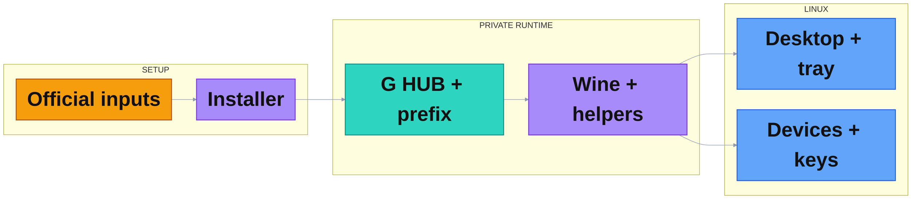

# Penguin LGHUB 02 Simple Connected 2026-10-29

2026/10/29 · A compact connected map. Purple is project compatibility, turquoise is G HUB, amber is downloaded inputs and blue is the Linux host. Setup leads to the original application, private runtime and host integration.

## Graph 1: System

