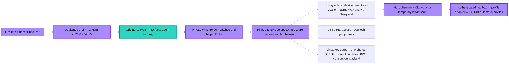
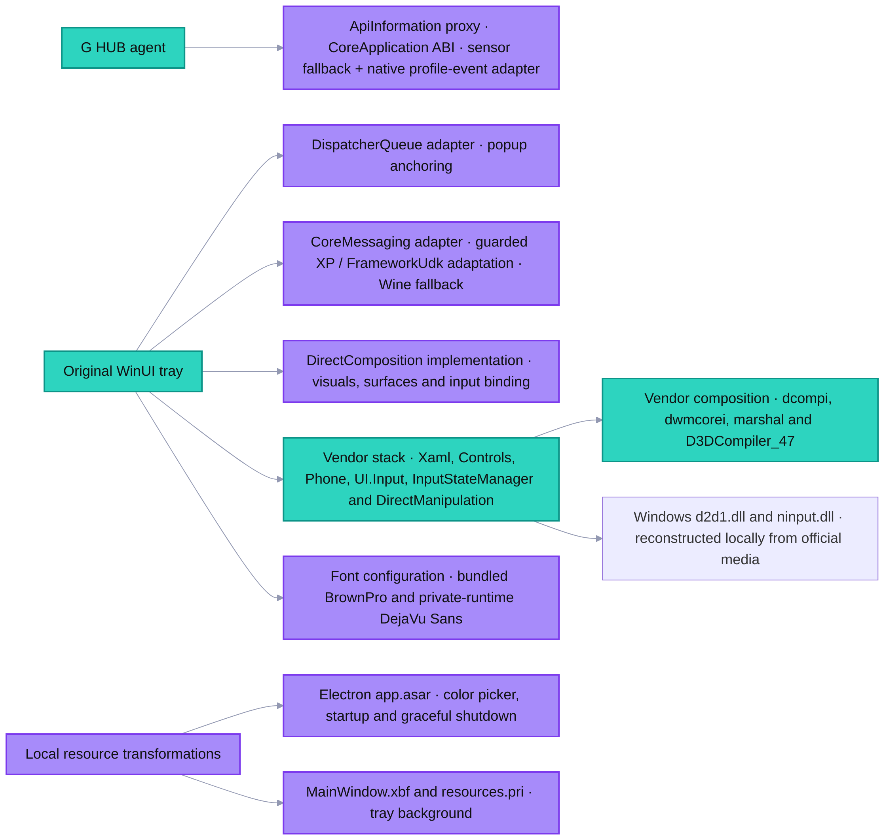
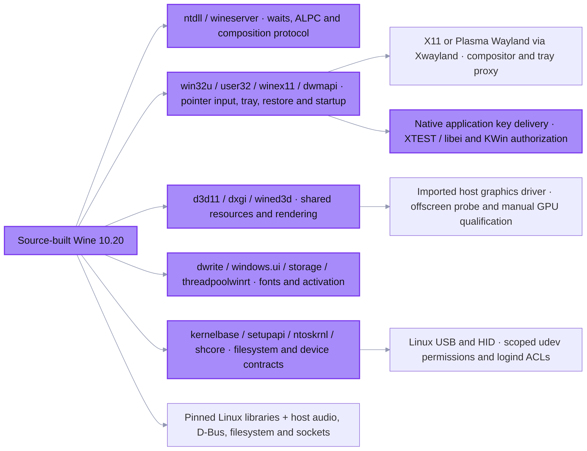

# Penguin LGHUB 03 Detailed Modular 2026-10-31

2026/10/31 · Six updated views of acquisition, source builds, launch, compatibility, Linux integration and evidence. Purple is project implementation; turquoise is vendor application code. Installation is confirmed on all three target distributions; native profiles have Manjaro acceptance.

## Graph 1: 1 · System overview

## Graph 2: 2 · Complete installer pipeline

```mermaid
%%{init: {"theme":"default","themeVariables":{"background":"transparent","fontSize":"18px","lineColor":"#9399b2","edgeLabelBackground":"#e8e8e8"},"themeCSS":".edgeLabel rect{opacity:1}","flowchart":{"htmlLabels":false,"useMaxWidth":false,"curve":"basis","padding":12,"nodeSpacing":45,"rankSpacing":55,"wrappingWidth":300}}}%%
flowchart LR
    A["install.sh · logo, colored steps and persistent logs"] --> B["Host preflight · session, namespaces, graphics, devices and policy"]
    B --> C["Private SDK and Wine 10.20 source · verified downloads"]
    C --> D["Apply 46 patch topics · build every replacement and helper"]
    E["Pinned Arch Wine base + Linux runtime + Node / test helpers"] --> F["Complete private runtimes · no host Wine or MinGW"]
    D --> F
    G["Official Windows media and updates"] --> H["Bubblewrap or rootless Podman reconstruction · 2 exact DLL hashes"]
    I["Official pinned Logitech depots · 30 archives"] --> J["Verify and extract · 1,115 depot files · 438 application files"]
    F --> K["Fresh prefix · registry, services, DLL overrides, depot state and resource fixes"]
    H --> K
    J --> K
    K --> L["Isolated loader, activation, UI and tray tests · offscreen host graphics/audio probe"]
    L --> P["Verify both profile backends and pinned agent adapter"] --> M["Scoped sudo device rule · one automatic Desktop and application-menu launcher"]
    M --> N["Commit installation · rollback on failure · receipt-scoped uninstall"]
    class P,N c1
    class A,B,C,D,F,H,J,K,L,M c1
    class G,I c2
    classDef c1 fill:#a78bfa,stroke:#7c3aed,color:#111,stroke-width:2px
    classDef c2 fill:#2dd4bf,stroke:#0d9488,color:#111,stroke-width:2px
```

## Graph 3: 3 · Desktop launch and application

```mermaid
%%{init: {"theme":"default","themeVariables":{"background":"transparent","fontSize":"18px","lineColor":"#9399b2","edgeLabelBackground":"#e8e8e8"},"themeCSS":".edgeLabel rect{opacity:1}","flowchart":{"htmlLabels":false,"useMaxWidth":false,"curve":"basis","padding":12,"nodeSpacing":45,"rankSpacing":55,"wrappingWidth":300}}}%%
flowchart LR
    A["Desktop entry"] --> B["desktop_runtime.py · integrity, session checks, ownership and readiness"]
    B --> C["pressure-vessel · pinned userspace with host graphics and session sockets"]
    C --> D["Private prefix · registrations, saved settings and DLL policy"]
    D --> E["lghub_agent.exe · devices, profiles, assignments, macros, G-Shift and lighting"]
    D --> F["lghub.exe · Electron interface"]
    D --> G["lghub_system_tray.exe · original WinUI menu"]
    F <-- "local API" --> E
    G <-- "agent integration" --> E
    B --> H["Update freeze · checks and downloads off · software manager blocked · application and depots read-only"]
    H --> I["lghub_updater.exe · service and lifecycle retained"]
    B --> J["Per-app NTSYNC masking · Wine server synchronization"]
    J --> C
    B -. "read-only readiness" .-> K["Bundled Node · agent snapshots"]
    K -. "local WebSocket" .-> E
    class A,B,C,D,H,J,K c1
    class E,F,G,I c2
    classDef c1 fill:#a78bfa,stroke:#7c3aed,color:#111,stroke-width:2px
    classDef c2 fill:#2dd4bf,stroke:#0d9488,color:#111,stroke-width:2px
```

## Graph 4: 4 · Supplementary components and resources

## Graph 5: 5 · Wine changes and Linux integration

## Graph 6: 6 · Validation and release boundary

```mermaid
%%{init: {"theme":"default","themeVariables":{"background":"transparent","fontSize":"18px","lineColor":"#9399b2","edgeLabelBackground":"#e8e8e8"},"themeCSS":".edgeLabel rect{opacity:1}","flowchart":{"htmlLabels":false,"useMaxWidth":false,"curve":"basis","padding":12,"nodeSpacing":45,"rankSpacing":55,"wrappingWidth":300}}}%%
flowchart LR
    A["Ghidra / DragonShard · development-only evidence"] --> B["Implementation and regression fixtures"]
    B --> C["Installer, removal, input and native-profile regression tests"]
    B --> D["Source build, fresh-prefix activation and isolated UI/tray checks"]
    D --> E["46 native modules + 53 dynamic libraries + real Windows command"]
    E --> F["8 activation factories · 4 registry routes · 6 first-run UI / tray checks"]
    F --> G["Manjaro and CachyOS · X11 / Wayland desktop testing"]
    G --> H["Installations confirmed on all three OSes · Manjaro native X11 and Wayland profiles confirmed"]
    I["GitHub source · no proprietary payloads, populated prefixes or analysis databases"] --> B
    H --> J["Remaining · new packaged-profile acceptance on CachyOS/Bazzite and component-use policy"]
    class A,B,C,D,E,F,G,H,I,J c1
    classDef c1 fill:#a78bfa,stroke:#7c3aed,color:#111,stroke-width:2px
    classDef c2 fill:#2dd4bf,stroke:#0d9488,color:#111,stroke-width:2px
```

