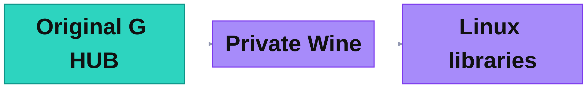
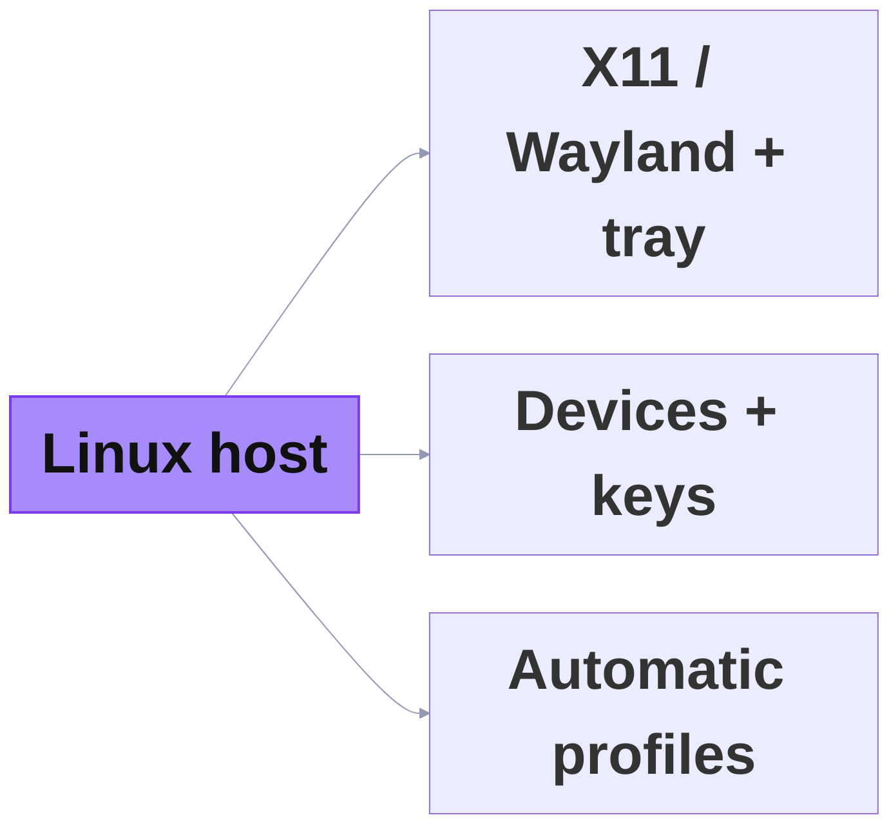

# Penguin LGHUB 01 Simple Modular 2026-10-31

2026/10/31 · Three compact views of setup, runtime and Linux integration. Purple is project compatibility code; turquoise is the original G HUB application. Detailed component maps follow in the repository.

## Graph 1: 1 · Install

## Graph 2: 2 · Run

## Graph 3: 3 · Connect

