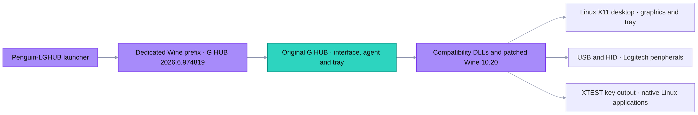
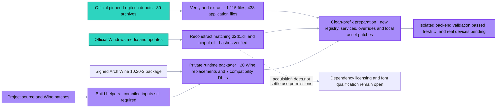
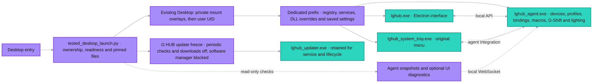
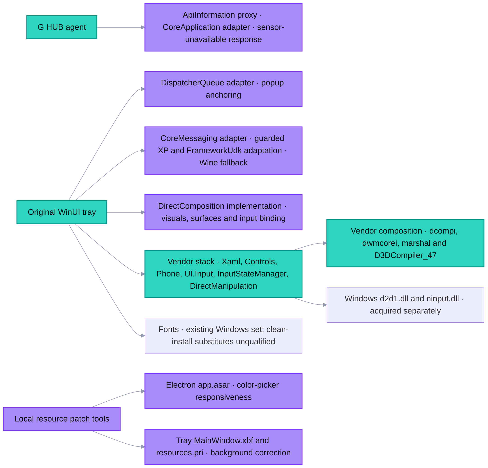
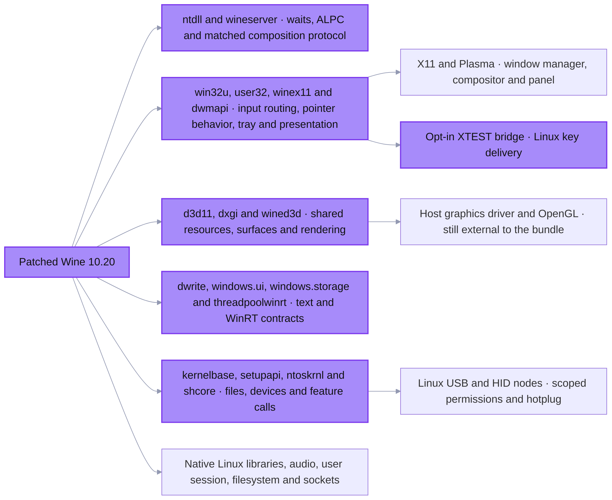

# Penguin LGHUB System

2026/10/26 · Six views of the existing Desktop setup and the fresh-install development pipeline. Proprietary dependencies are acquired locally; cross-machine GUI and device qualification remains pending.

## Graph 1: 1 · System overview

## Graph 2: 2 · Reproducible preparation

## Graph 3: 3 · Desktop launch and application

## Graph 4: 4 · Supplementary components and resources

## Graph 5: 5 · Wine changes and host integration

## Graph 6: 6 · Evidence and remaining release work

```mermaid
%%{init: {"theme":"default","themeVariables":{"background":"transparent","fontSize":"18px","lineColor":"#9399b2","edgeLabelBackground":"#e8e8e8"},"themeCSS":".edgeLabel rect{opacity:1}","flowchart":{"htmlLabels":false,"useMaxWidth":false,"curve":"basis","padding":12,"nodeSpacing":45,"rankSpacing":55,"wrappingWidth":300}}}%%
flowchart LR
    A["DragonShard and Ghidra · development-only analysis"] --> B["Implementation, regression fixtures and saved findings"]
    B --> C["Existing Desktop · six feature groups accepted by owner on Manjaro X11"]
    B --> D["Fresh prefix · 8 factories, 4 registry routes, 1 service and 5 API routes passed"]
    D --> E["Packaged runtime · relocation and archive restore passed"]
    E --> F["Next: rebuild recipe, Linux-library portability and fonts"]
    F --> G["Fresh Manjaro control · original UI, tray, devices and input"]
    G --> H["CachyOS · driver, session, permissions and hotplug differences"]
    H --> I["Later: Debian qualification"]
    J["GitHub source · no proprietary DLLs, populated prefixes or analysis corpus"] -. "supports review and reproduction work" .-> B
    class A,B,D,E,F,G,H,I,J c1
    classDef c1 fill:#a78bfa,stroke:#7c3aed,color:#111,stroke-width:2px
    classDef c2 fill:#2dd4bf,stroke:#0d9488,color:#111,stroke-width:2px
```

